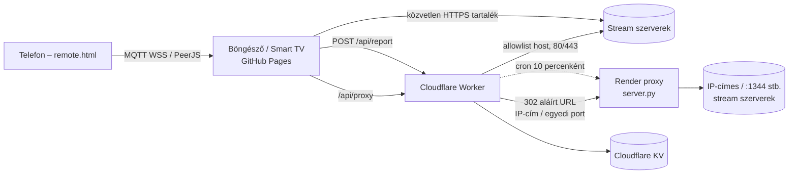

# 📺 ZsirafVision - Online IPTV & Web Player (v4.5)

Korszerű, 100%-ban felhő alapú IPTV webes televízió és médialejátszó: **131 élő magyar csatorna**, 6 nyelvű felület és súgó, valós idejű EPG, kedvencek, elalvásidőzítő, MQTT + WebRTC mobil távirányító (QR-kód), telepíthető PWA, Samsung Tizen / LG webOS támogatás és felhős hibajelentő.

* **Élő Web App (GitHub Pages):** https://zsirafmix.github.io/zsirafvision/public/
* **Mobil távirányító:** https://zsirafmix.github.io/zsirafvision/public/remote.html
* **Proxy 1 – Cloudflare Worker:** `https://zsirafvision-proxy.gamsgoworld.workers.dev` (`cloudflare-worker/`, cím: `public/js/app.js` → `PROXY_BASE`)
* **Proxy 2 – Render:** `https://zsirafvision-proxy2.onrender.com` (`server.py`)
* **Aktuális verzió:** `v4.5` – [Változásnapló](CHANGELOG.md) · [Kiadások](https://github.com/zsirafmix/zsirafvision/releases)
* **Dokumentáció:** [Architektúra](docs/ARCHITECTURE.md) · [Biztonság](docs/SECURITY.md) · [Telepítés & üzemeltetés](docs/DEPLOY.md)

---

## 🚀 Főbb funkciók és képességek

* **❓ Többnyelvű Használati Útmutató & Súgó Rendszer (v4.0 - v4.2):**
  * Egyetlen kattintással az alsó sávban lévő `❓ SÚGÓ` gombra vagy a billentyűzeten a `H` / `?` billentyűre kinyílik a teljes körű retro használati útmutató.
  * **6 Nyelven elérhető:** Magyar (`hu`), angol (`en`), német (`de`), francia (`fr`), spanyol (`es`) és orosz (`ru`) nyelven, valós idejű nyelvváltással.
  * **10 Részletes Témakör:** Élő adások, csatornalista és keresés, kedvencek, műsorújság (EPG), elalvásidőzítő & készenlét, mobil távirányító, telepíthető PWA zsebtévé, többnyelvű felület, billentyűzet és okostévé vezérlés, technikai statisztikák & hibajelentő (a titkos felnőtt mód szándékosan rejtve, diszkrét húsvéti tojásként marad).
  * **Azonnali Keresés és Kategóriaszűrők:** Valós idejű szűrés címre, összefoglalóra és billentyűkre.
  * **Automatikus és Moduláris Jövőbeli Bővíthetőség:** A súgó adatai az `i18n.js` `HELP_GUIDE` struktúrájából renderelődnek. Új funkciók beépítésekor elegendő egyetlen új bejegyzést felvenni a 6 nyelven, és a felület automatikusan, HTML szerkesztés nélkül leköveti és megjeleníti azt!

* **⭐ Kedvencek (Favorites) rendszer (v3.7):**
  * Egykattintásos csillagozás közvetlenül a képernyőn (OSD csillag gomb) vagy a csatornalistában minden adó mellett.
  * `⭐ Kedvencek` kategóriaszűrő fül a csatornaválasztó fiókban, amely azonnal listázza a megjelölt kedvenc adókat a darabszámukkal együtt.
  * Tartós elmentés a böngésző `localStorage` tárhelyében.
* **🌙 Elalvásidőzítő & Készenléti (Standby) Mód (v3.7):**
  * Beállítható időzítő: 15, 30, 45, 60, 90, 120 perc vagy kikapcsolva.
  * Valós idejű visszaszámlálás az alsó sáv gombján és az időzítő ablakban.
  * Lágy hangerő-lehalkítás (audio fade-out) a lejárás előtti utolsó 10 másodpercben.
  * Lejáratkor automatikus készenléti mód (Standby): a videó stream leáll, energiatakarékos retro sötétített képernyő jelenik meg világító piros LED-del és bekapcsoló gombbal.
* **📱 Mobil Távirányító QR-kóddal (WebRTC / PeerJS) (v3.7):**
  * **Zéró helyi szerver**: Nincs szükség semmilyen program vagy szerver futtatására a PC-n, a kapcsolatot a felhős PeerJS relay biztosítja közvetlen P2P WebRTC kapcsolaton keresztül.
  * A TV képernyőjén megjelenő QR-kódot a telefon kamerájával beolvasva azonnal megnyílik a mobilra optimalizált retro távirányító (`remote.html`).
  * Kétirányú valós idejű szinkronizáció: a telefon mini CRT kijelzőjén azonnal látszik a tévén épp futó csatorna neve, száma, műfaja, hangereje és készenléti állapota.
  * Teljes távirányító funkciók: CH+/CH-, VOL+/VOL-, Mute, 0-9 számbillentyűk, OK, Guide, EPG, Kedvenc, Teljes képernyő, Elalvásidőzítő és haptikus rezgés.
* **📲 Tévé formában telepíthető PWA Mobil App (v3.7):**
  * Progressive Web App (`manifest.json`, `sw.js`), amely telefonon és táblagépen a kezdőképernyőre helyezhető.
  * Böngésző keret nélkül, teljes képernyős **fekvő (landscape) tájolásban** indul el igazi zsebtévéként.
  * Dedikált 192x192 és 512x512 képpontos retro arany-fekete televízió ikonok.
  * Offline UI héj gyorsítótárazás Service Workerrel (a videóstreamek és felhős API-k közvetlen átengedésével).

* **Utolsóként nézett csatorna és ország megjegyzése (v3.6):**
  * A lejátszó a `localStorage` segítségével automatikusan megjegyzi az utolsóként nézett csatornát és a forrást (`HU`, `WORLD`, `XXX`).
  * Következő megnyitáskor azonnal az utoljára nézett adó indul el, és a forrásválasztó is automatikusan a megfelelő országra/listára áll át.
* **6 Nyelvű Kezelőfelület (i18n) (v3.6):**
  * Teljes felületi fordítás: 🇭🇺 Magyar (`hu`), 🇬🇧 Angol (`en`), 🇩🇪 Német (`de`), 🇫🇷 Francia (`fr`), 🇪🇸 Spanyol (`es`) és 🇷🇺 Orosz (`ru`).
  * Automatikus böngészőnyelv-felismerés és azonnali, mentett nyelvváltó az alsó vezérlősávban és a csatornalista fejlécében.
* **Minden Csatornára Kiterjesztett Műsorújság (EPG) (v3.6):**
  * Részletes XMLTV adatok a hazai adókhoz + intelligens, időpont- és műfajfüggő valós idejű műsorfolyam-generátor nemzetközi és egyéb csatornákhoz.
  * A műsorcímek és leírások a kiválasztott felületi nyelven jelennek meg, aktuális „ÉLŐBEN / LIVE” jelöléssel.
* **Mobilos Billentyűzet Felugrásának Megakadályozása (v3.6):**
  * A csatornalista és az alkalmazás megnyitásakor mobilon/tableten nem ugrik fel zavaróan a virtuális billentyűzet; csak akkor jelenik meg, ha a felhasználó közvetlenül a keresőmezőbe kattint.
* **131 Élő Magyar IPTV Csatorna (24/7):**
  * Országos, közszolgálati, film-, sorozat-, sport-, hír-, zenei, gyermek- és ismeretterjesztő csatornák kristálytiszta digitális minőségben.
* **Samsung Smart TV (Tizen OS) & Okostévé Teljes Kompatibilitás:**
  * Hardveres videósík rétegpromóció (`transform: translateZ(0)`), főszálon futó demuxolás (`enableWorker: false`), Smart TV watchdog és távirányító támogatás (Return: `10009`, Csatornaváltás: `427`/`428`).
* **Két proxys felhős backend (Cloudflare Worker + Render, v4.3–v4.4):**
  * Teljes CORS és Mixed Content feloldás, M3U8 és TS URL-ek dinamikus átírása.
  * **HTTP 206 Partial Content & Range fejlécek támogatása:** azonnali lejátszásindítás.
  * Zéró helyi függőség: **nem kell futnia semmilyen szervernek a felhasználó számítógépén**.
* **Telemetria és Hibajelentő (`HIBAJELENTŐ` gomb):**
  * A tévékészülék káváján elhelyezett piros gomb megnyomásával az adáshibákról szóló diagnosztikai adatok felküldhetők a felhőbe (`/api/report`).
* **Valós idejű Technikai Statisztikák (⚙ Gomb):**
  * Élő ping mérés a proxy szerverhez, stream felbontás, bitráta, puffer és eldobott képkockák kijelzése.
* **Nemzetközi Adások és Titkos Felnőtt Mód:**
  * Globális forrás választó: `iptv-org` nemzetközi csatornák elérhetősége.
  * A csatornakeresőbe az `xxx` szót beírva feloldódik 33 db ellenőrzött, működő felnőtt élő és VOD mozi adás.

---

* **🔒 Biztonság (v4.5):** szigorú host allowlist, HMAC-aláírt proxy URL-ek, SSRF védelem, CSP + SRI, 130 bites szobakód – részletek: [docs/SECURITY.md](docs/SECURITY.md).

---

## ☁️ Architektúra



* **GitHub Pages** – a statikus front-end (`public/`).
* **Cloudflare Worker** – elsődleges proxy (M3U8 átírás, Range/206), hibajelentések (KV), statisztika. Nem ér el IP-címes hostot (CF 1003) és nem szabványos portot, ezeket aláírt 302-vel a Renderhez küldi.
* **Render** – második proxy a Worker által nem elérhető streamekhez; a Worker cronja ébren tartja.
* Részletek: [docs/ARCHITECTURE.md](docs/ARCHITECTURE.md)

## 🚀 Telepítés és üzemeltetés (röviden)

| Mit | Hogyan |
|---|---|
| Front-end | push a `main`-re → GitHub Pages automatikusan |
| Worker | `cd cloudflare-worker && npx wrangler deploy` |
| Worker secretek | `REPORT_TOKEN`, `RENDER_SIGN_KEY` – `npx wrangler secret put <NÉV>` |
| Render env | `RENDER_SIGN_KEY` (azonos a Workerével), opcionális `TLS_INSECURE_HOSTS` |
| Keep-warm | `wrangler.toml` → `crons = ["*/10 * * * *"]` (Render `/health`) |
| Allowlist | `python3 tools/gen_allowed_hosts.py`, majd Worker deploy |

Titkok értékei soha nem kerülnek a repóba. Teljes leírás: [docs/DEPLOY.md](docs/DEPLOY.md)

### Hibajelentések kiolvasása
```bash
curl -H "Authorization: Bearer $REPORT_TOKEN" "https://zsirafvision-proxy.gamsgoworld.workers.dev/api/report?limit=50"
```
Legújabb elöl, max. `?limit=200`. Korlát: IP-nként 5 jelentés / 10 perc, max. 16 KB, 90 napig tárolva.

### Csatornateszt
```bash
python3 tools/channel_test.py              # összesítés + nem működő csatornák listája
python3 tools/channel_test.py --json r.json
WORKER=https://masik-worker.workers.dev python3 tools/channel_test.py
```

## 📡 Ismert nem működő csatornák (2026-10-30, v4.5 teszt)

A `tools/channel_test.py` alapján (Worker → Render útvonal). Ezek forrásoldali hibák, nem a lejátszóé:

| Csatorna | Hiba | Ok |
|---|---|---|
| Berente TV, Komlós TV, PilisTV, RégióPlusz TV, Trimedio TV, Globo TV (streaming4u.hu) | 403 | földrajzi tiltás / a szolgáltató a felhős IP-ket tiltja |
| AXN Spin | 429 | forrás korlátozás |
| BTV | időtúllépés | a forrás nem válaszol |
| Vásárhelyi Televízió | 413 / 404 | hibás, túl nagy forrás válasz |
| EbS, EbS+, ESTV, Jászsági Térségi TV, Makói Városi TV | csak playlist | üres vagy szegmens nélküli playlist |
| Alföld, Bajai, Gyöngyösi, Kapos, Karcag TV (lexanetwork :1344) | 502 | TLS tanúsítvány hiba – a v4.5 javítás (`.lexanetwork.com` TLS-kivétel) Render redeploy után él |

## 🔢 Verziózás

* `vX.Y` formátum: **X** = nagy (architektúra) változás, **Y** = funkció / javítás kiadás. Ugyanazon a napon belüli javítások a futó verzió `Javítva` részébe kerülnek, nem léptetnek verziót.
* Minden verzióhoz: bejegyzés a [CHANGELOG.md](CHANGELOG.md)-ben (Keep a Changelog: Hozzáadva / Változott / Javítva / Biztonság / Törölve), git tag (`vX.Y`) és GitHub Release ugyanazzal a szöveggel.
* Verzióváltáskor frissítendő: `app.js` és `i18n.js` verziószöveg, `index.html` / `remote.html` `?v=` tagek, `sw.js` cache név, `wrangler.toml` fejléc, `server.py` `VERSION`, README.

## 🛠️ Samsung Smart TV (Tizen OS) - Technikai hibajavítás (v3.5)

### A hiba oka
A Samsung Smart TV böngészője (Tizen OS) a hardveres videódekódolást egy különálló hardveres videósíkon („video hole”) végzi. Ha:
1. Egy szülő elemen CSS `filter` (pl. `filter: drop-shadow(...)`) található, a Tizen kompozitor nem tudja átütni a videósíkot a szűrőrétegen keresztül, így **a hang szól, de a kép teljesen fekete marad**.
2. A Hls.js lejátszó `enableWorker: true` beállítással fut, az alacsonyabb specifikációjú okostévés WebKit WebView-ban a Web Worker nem tudja megbízhatóan átadni a videóframe-eket a főszálnak, így a demuxer leállítja a videó renderelését.
3. A videókonténer `border-radius` lekerekítéssel bír, ami bizonyos Tizen verziókban hardveres vágási hibát okoz.

### A v3.5-ben bevezetett megoldások:
1. **CSS javítás**: A `.tv-cabinet` konténerről eltávolítottuk a `filter: drop-shadow(...)` szabályt, és szabványos `box-shadow`-ra cseréltük.
2. **GPU rétegpromóció**: A `<video>` elem megkapta a `transform: translateZ(0); -webkit-transform: translateZ(0); backface-visibility: hidden;` hardveres gyorsítást.
3. **Okostévé felismerés (`isSmartTV`)**: A `navigator.userAgent` alapján azonosítja a Samsung Tizen, LG webOS és SmartTV környezetet, és kikapcsolja a lekerekítéseket (`border-radius: 0`).
4. **Hls.js Worker kikapcsolás (`enableWorker: false`)**: A demuxolás a főszálon fut, megkerülve a Web Worker memóriaszál-hibát.
5. **Intelligens Videó Watchdog**: Ha a lejátszás elindult, de 4 másodperc elteltével a `videoWidth` még mindig 0 (csak hang hallható), a rendszer automatikusan átkapcsol a TV natív HLS motorjára (`video.src = streamUrl`).

---

## ⌨️ Irányítás & Távirányító billentyűk

| Billentyű / Távirányító gomb | Funkció |
| :--- | :--- |
| `Fel` / `Jobbra` / `Channel Up` | Következő csatorna |
| `Le` / `Balra` / `Channel Down` | Előző csatorna |
| `Enter` / `OK` | Némítás feloldása / Teljes képernyő |
| `Vissza` / `Return` (Tizen: `10009`) | Oldalsáv / műsorújság bezárása, kilépés teljes képernyőből |
| `Play` / `Pause` | Adás megállítása / folytatása |
| `+` / `-` | Hangerő szabályozás |
| `M` | Hang némítása / visszakapcsolása |
| `F` | Teljes képernyős mód (Full HD) |
| `C` | Csatornalista megnyitása |
| `P` | Műsorújság megnyitása |
| `H` / `?` / `F1` | Használati útmutató & Súgó megnyitása / bezárása |

---

## 📝 Verziótörténet

A teljes, verziónkénti változásnapló: **[CHANGELOG.md](CHANGELOG.md)** · kiadások: **[GitHub Releases](https://github.com/zsirafmix/zsirafvision/releases)**

| Verzió | Dátum | Fő változás |
|---|---|---|
| v4.5 | 2026-10-30 | Biztonsági csomag (allowlist, aláírt URL-ek, CSP/SRI), dokumentáció |
| v4.4 | 2026-10-30 | Render második proxy, keep-warm cron |
| v4.3 | 2026-10-30 | Vercel → Cloudflare Worker |
| v4.2 | 2026-10-29 | EPG élő műsor kiemelés |
| v4.1 | 2026-10-29 | Súgó ablak javítás |
| v4.0 | 2026-10-29 | Többnyelvű súgó |
| v3.9 | 2026-10-29 | MQTT távirányító |
| v3.8 | 2026-10-29 | Távirányító P2P javítások |
| v3.7 | 2026-10-29 | Kedvencek, elalvásidőzítő, távirányító, PWA |
| v3.6 | 2026-10-29 | 6 nyelv, utolsó csatorna, bővített EPG |
| v3.5 | 2026-10-29 | Samsung Tizen javítás |
| v3.4 | 2026-10-29 | Range/206, kettős lejátszómotor |
| v3.3 | 2026-10-29 | EPG, hibajelentő, statisztika |
| v3.2 | 2026-10-29 | Logó CORS javítás |
| v3.1 | 2026-10-29 | Vercel proxy |
| v3.0 | 2026-10-28 | Első kiadás |
