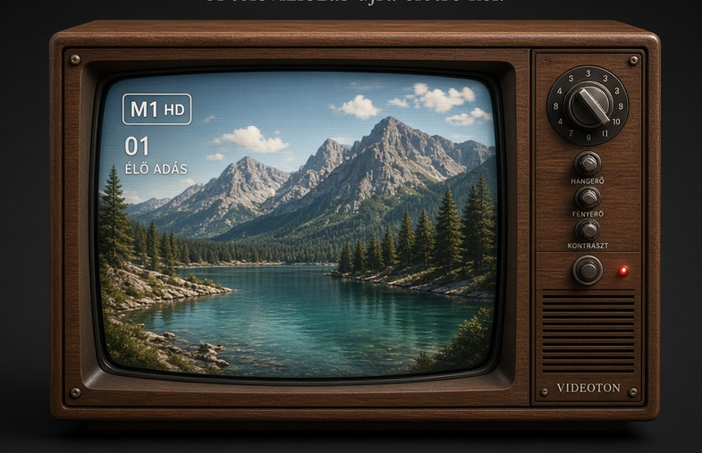

# 📺 ZsirafVision - Videoton Retro IPTV

Autentikus magyar **Videoton retro televízió** élmény böngészőben, 131 igazoltan élő magyar nyelvű IPTV csatornával.



## ✨ Jellemzők

* **131 Élő Magyar IPTV Csatorna:** Filmek, sorozatok, sport, rajzfilmek, dokumentumfilmek, hírek, zene és helyi televíziók.
* **Autentikus Videoton Faház & CRT Kijelző:**
  * Görbült katódsugárcsöves (CRT) üvegfelület és scanline (sorminta) réteg.
  * Realisztikus bekapcsolási és kikapcsolási vonal-összeesés animáció.
  * Működő piros LED állapotjelző.
  * Hangolási analóg fehér zaj ("hangyás kép") csatornaváltáskor.
* **Működő Analóg Kezelőszervek:**
  * **Forgótárcsás csatornaváltó (Rotary Dial):** Forgatásra vagy kattintásra forgó tárcsa mechanikus kattogó hanggal.
  * **HANGERŐ (Volume) gomb:** Szabályozza a hangerőt valós idejű OSD kijelzéssel.
  * **FÉNYERŐ (Brightness) gomb:** Valós idejű CSS szűrő a CRT kép fényerejéhez.
  * **KONTRASZT (Contrast) gomb:** Valós idejű kontrasztállítás.
  * **BE/KI kapcsoló gomb:** A tévé kikapcsolása klasszikus foszforcsík-eltűnéssel.
* **OSD (On-Screen Display):**
  * Retro zöld/fehér kijelző a képernyő sarkában: csatornaszám (`01`), csatornanév (`M1 HD`), kategória és villogó `ÉLŐ ADÁS` jelzés.
* **CSATORNAVÁLASZTÓ Műsorújság (Drawer):**
  * 131 csatorna kategóriák szerint (Filmek, Sport, Gyerek, Hírek, Zene, Dokumentum, Helyi TV, stb.).
  * Villámgyors keresőmező.
* **Web Audio API szintetizált hangok:** Nem igényel külső hangfájlokat, a mechanikus kattanások és zajok a böngészőben szintetizálódnak.
* **Beépített Python HLS Proxy:** Külső függőség nélkül megoldja a CORS és Mixed Content korlátokat, így minden csatorna zökkenőmentesen játszható le.

---

## 🚀 Használat és Indítás

### Helyi futtatás (Ajánlott, 100%-os csatorna-elérés):

1. Nyiss egy terminált a projekt mappájában:
   ```bash
   cd zsirafvision
   ```
2. Indítsd el a rendszert az indítószkripttel:
   ```bash
   ./start.sh
   ```
   vagy közvetlenül Pythonnal:
   ```bash
   python3 server.py
   ```
3. Nyisd meg a böngésződben:
   👉 **http://localhost:8080**

---

## ⌨️ Billentyűparancsok

| Billentyű | Funkció |
| :--- | :--- |
| `Fel` / `Jobbra` | Következő csatorna |
| `Le` / `Balra` | Előző csatorna |
| `+` / `-` | Hangerő növelése / csökkentése |
| `Szóköz` | TV be- és kikapcsolása |
| `M` | Némítás / visszahangosítás |
| `F` | Teljes képernyős mód |
| `C` vagy `L` | Csatornalista / Műsorújság megnyitása |
| `0` - `9` | Közvetlen csatornaválasztás |

---

## 📁 Projekt struktúra

```
zsirafvision/
├── server.py              # Python HTTP szerver és HLS M3U8 proxy
├── start.sh               # Egykattintásos indító szkript
├── public/                # Webes felület
│   ├── index.html         # Főoldal és TV struktúra
│   ├── channels.json      # 131 tesztelt, élő magyar csatorna metaadatai
│   ├── css/
│   │   └── style.css      # Videoton design, CRT fények, animációk
│   ├── js/
│   │   └── app.js         # Lejátszó vezérlés, hangok, HLS.js motor
│   └── assets/            # TV képkeret és textúrák
└── README.md
```

Készült a Google DeepMind Antigravity segítségével.
