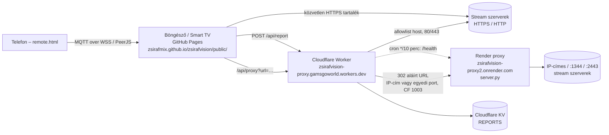

# Architektúra (v4.5)

## Komponensek

| Komponens | Hol | Feladat |
|---|---|---|
| Front-end (`public/`) | GitHub Pages | Lejátszó (hls.js), EPG, kedvencek, súgó, PWA, távirányító-párosítás |
| Worker (`cloudflare-worker/worker.js`) | Cloudflare | `/api/proxy` (M3U8 átírás, aláírt gyerek-URL-ek, Range/206), `/api/report`, `/api/stats`, `/health`, cron |
| Render proxy (`server.py`) | Render (Python) | Amit a Worker nem ér el: IP-címes hostok, nem szabványos portok |
| Allowlist (`public/allowed_hosts.json`) | repó | Közös engedélyezett host lista a két proxynak (`tools/gen_allowed_hosts.py`) |
| Távirányító (`remote.html`, `js/remote.js`) | GitHub Pages | MQTT (HiveMQ / EMQX WSS) elsődlegesen, PeerJS másodlagosan |

## Lejátszási folyamat
1. `app.js` `getStreamCandidates`: először Worker (`PROXY_BASE`), utána közvetlen HTTPS.
2. A Worker ellenőrzi a hostot (allowlist vagy érvényes aláírás), lekéri a playlistet, a gyerek-URL-eket aláírt Worker URL-ekre írja át.
3. IP-címes vagy nem 80/443 portos célnál (vagy CF 1003 / hálózati hiba esetén) aláírt 302 a Render proxyhoz; a Render a playlist gyerek-URL-jeit saját, aláírt abszolút URL-jeire írja.
4. hls.js a relatív URL-eket az átirányítás utáni végső címhez képest oldja fel.

## Aláírás
`sig = base64url(HMAC-SHA256(RENDER_SIGN_KEY, "url|exp|ua|ref")[:18])`, `exp = most + 6 óra`. Paraméterek: `url, ua, ref, exp, sig`. Ugyanaz a kulcs a Workerben és a Renderen.
