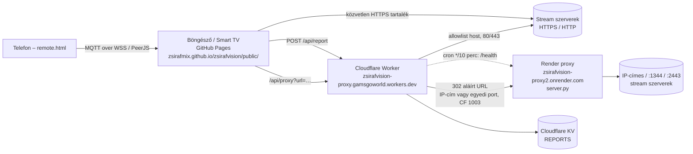

# Architektúra (v4.5)



## Komponensek

| Komponens | Hol | Feladat |
|---|---|---|
| Front-end (`public/`) | GitHub Pages | Lejátszó (hls.js), EPG, kedvencek, súgó, PWA, távirányító-párosítás |
| Worker (`cloudflare-worker/worker.js`) | Cloudflare | `/api/proxy` (M3U8 átírás, aláírt gyerek-URL-ek, Range/206), `/api/report`, `/api/stats`, `/health`, cron |
| Render proxy (`server.py`) | Render (Python) | Amit a Worker nem ér el: IP-címes hostok, nem szabványos portok |
| Allowlist (`public/allowed_hosts.json`) | repó | Közös engedélyezett host lista a két proxynak (`tools/gen_allowed_hosts.py`) |
| Távirányító (`remote.html`, `js/remote.js`) | GitHub Pages | MQTT (HiveMQ / EMQX WSS) elsődlegesen, PeerJS másodlagosan |

## Lejátszási folyamat
1. `app.js` `getStreamCandidates`: először Worker (`PROXY_BASE`), utána közvetlen HTTPS.
2. A Worker ellenőrzi a hostot (allowlist vagy érvényes aláírás), lekéri a playlistet, a gyerek-URL-eket aláírt Worker URL-ekre írja át.
3. IP-címes vagy nem 80/443 portos célnál (vagy CF 1003 / hálózati hiba esetén) aláírt 302 a Render proxyhoz; a Render a playlist gyerek-URL-jeit saját, aláírt abszolút URL-jeire írja.
4. hls.js a relatív URL-eket az átirányítás utáni végső címhez képest oldja fel.

## Aláírás
`sig = base64url(HMAC-SHA256(RENDER_SIGN_KEY, "url|exp|ua|ref")[:18])`, `exp = most + 6 óra`. Paraméterek: `url, ua, ref, exp, sig`. Ugyanaz a kulcs a Workerben és a Renderen.


## Élő nézőszámláló (v4.6.1)

```
böngésző ──POST /api/heartbeat {sid,ch} (60 mp)──▶ Worker ──▶ Durable Object "ViewerCounter" (id: global)
böngésző ──GET  /api/viewers (45 mp)──────────────▶ Worker ──▶ ugyanaz a DO → {total, perChannel}
```

**Tárolási döntés:** egyetlen globális Durable Object (SQLite-alapú osztály, a Workers ingyenes csomagjában elérhető), az állapotot **csak memóriában** (Map: sid → {ch, időbélyeg}) tartja.
- *Miért nem KV?* A KV ingyenes keret napi 1000 írás; 5 néző × 60 mp-es jelzés már ~7200 írás/nap lenne, és a KV végül konzisztens (akár 60 mp késés).
- *Miért nem Cache API / Worker memória?* Az adatközpontonként/isolate-onként külön lenne, így a szám nem globális.
- *DO előnye:* egy példány látja az összes nézőt → pontos szám; nincs tárhely-írás. Költség: minden jelzés 1 DO-kérés (ingyen napi 100 000 Worker + DO kérés közös kerettel). 50 egyidejű néző ≈ 72 000 jelzés/nap.
- *Korlát:* ha a DO-t a Cloudflare kiüríti (tétlenség, újratelepítés), a számláló nulláról indul, és legfeljebb 60 mp alatt újra feltöltődik. Ez elfogadható egy „most néz” kijelzőnél.
- Ablak: 120 mp (2 kihagyott jelzés után esik ki a néző); `stop: true` azonnal törli.


## v4.7.0 – proxy failover
Worker → `PROXY_BACKENDS` (prioritás + körbeforgatás) → server.py példányok (Render, …). Egészség: cron 10 percenként, állapot KV `backend-health`. Részletek: PROXY_BACKENDS.md.
